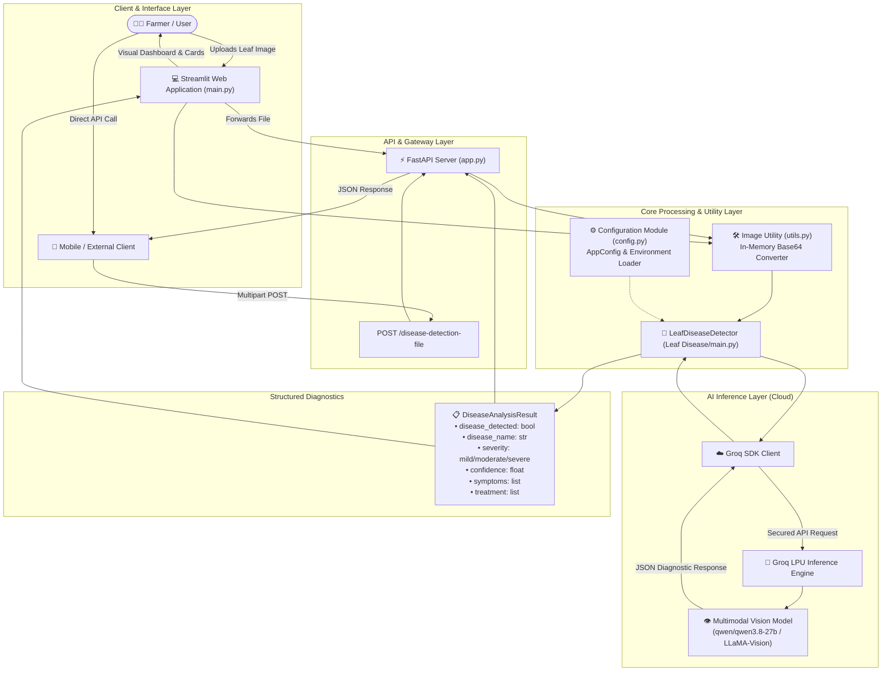

# MINI-PROJECT SYNOPSIS

| **MAHARAJA INSTITUTE OF TECHNOLOGY MYSORE**<br>**Department of Artificial Intelligence** |
|:---:|

---

### Project Metadata

- **Project Title:** AI-Powered Plant Leaf Disease Detection and Advisory System Using Vision-Language Models
- **Project Team No.:** [Team No. - To be filled by students]
- **Semester / Section:** VI / VII Semester, Section [A / B]
- **Student Name(s) & USN:** 
  - [Student Name 1] — [USN 1]
  - [Student Name 2] — [USN 2]
  - [Student Name 3] — [USN 3]
  - [Student Name 4] — [USN 4]
- **Guide Name:** [Faculty Guide Name, Designation]
- **Academic Year:** 2025 – 2026

---

## 1. Abstract

Agricultural crop yield and food security are severely threatened by plant foliar diseases, which cause up to 40% of global harvest losses annually. Conventional diagnostic practices rely on manual visual examination by phytopathology experts, an approach that is geographically inaccessible, slow, and expensive for rural farmers. This project develops an end-to-end, intelligent leaf disease detection and treatment advisory system utilizing cutting-edge Multimodal Vision-Language Models (VLMs) via ultra-low-latency Groq Cloud inference (`qwen/qwen3.8-27b` / Meta Llama Vision). 

Unlike legacy convolutional neural networks (CNNs) that only provide rigid class labels, this solution performs multi-dimensional diagnostic reasoning: it verifies whether the submitted image contains a genuine plant leaf, identifies over 500+ diseases (fungal, bacterial, viral, pest-induced, and abiotic nutrient deficiencies), stratifies disease severity (mild, moderate, severe), computes confidence scores, explains observable visual symptoms, and generates actionable agronomic treatment regimens (chemical, biological, and preventive cultural practices). The system is implemented via a decoupled architecture featuring a high-performance **FastAPI** backend REST API and an interactive, responsive **Streamlit** web user interface, enabling real-time diagnoses in under 3 to 5 seconds.

---

## 2. Introduction

Agriculture remains the backbone of the global economy, yet early detection of crop leaf pathologies remains an unsolved operational hurdle for smallholder farming communities. Recent breakthroughs in Artificial Intelligence—specifically in multimodal computer vision and Large Language Models (LLMs)—have opened new paradigms for precision agriculture.

Traditional computer vision approaches rely on supervised classifiers trained on isolated datasets (such as PlantVillage). While effective under controlled laboratory lighting, these models degrade sharply in field settings and cannot generate explanatory diagnostic narratives. 

This project bridges this gap by introducing an AI-driven Leaf Disease Detection System powered by state-of-the-art Vision-Language Models. The system accepts leaf photographs captured by consumer smartphones, streams them via an in-memory asynchronous pipeline, and queries high-speed Language Processing Units (LPUs) via the Groq API. It delivers not only disease identification, but also contextual disease profiling, severity assessments, probable environmental triggers, and step-by-step mitigation plans in natural language.

---

## 3. Problem Statement

Smallholder and commercial farmers face recurring crop failures due to delayed or inaccurate diagnosis of foliar diseases. The core problems addressed in this project include:

1. **Scarcity of Plant Pathologists:** High ratio of farming acreage to agricultural extension officers, leaving farmers without timely diagnosis.
2. **Inadequacy of Traditional Classification Models:** Conventional deep learning models (ResNet, MobileNet, VGG) output single scalar labels without explaining *why* a disease is diagnosed or *what* remediation actions must be taken.
3. **Absence of Severity and Cause Analysis:** Standard detectors do not distinguish between early-stage curable infections and terminal damage, leading to misapplied agrochemicals.
4. **Vulnerability to Out-of-Domain Inputs:** Typical classification models lack guardrails and classify arbitrary images (such as human faces or domestic animals) as diseased crops.
5. **High Latency and Computational Overhead:** Running large multimodal models locally on edge devices is hardware-prohibitive for rural deployments.

---

## 4. Literature Survey

1. **Mohanty, S. P., Hughes, D. P., & Salathé, M. (2016). *Using Deep Learning for Image-Based Plant Disease Detection*. Frontiers in Plant Science.**
   - *Key Findings:* Demonstrated that Deep Convolutional Neural Networks (AlexNet and GoogLeNet) could classify 26 diseases across 14 crop species with 99.35% accuracy on the PlantVillage dataset.
   - *Inference for Project:* Highlighted that CNN models overfit laboratory backgrounds and lack generalization to real-world ambient conditions.

2. **Ferentinos, K. P. (2018). *Deep learning models for plant disease detection and diagnosis*. Computers and Electronics in Agriculture.**
   - *Key Findings:* Evaluated VGG, AlexNet, and ResNet architectures for 58 plant disease classes, achieving 99.53% validation accuracy.
   - *Inference for Project:* Emphasized that pure classification lacks actionable advisory outputs; farmers still require domain experts to prescribe treatments.

3. **Saleem, M. H., Potgieter, J., & Arif, K. M. (2019). *Plant Disease Detection and Classification by Deep Learning*. IEEE Access.**
   - *Key Findings:* Comprehensive survey identifying class imbalance, lighting variation, and lack of severity stratification as primary roadblocks in deploying agricultural AI.
   - *Inference for Project:* Underlined the need for uncertainty estimation, confidence quantification, and multi-disease contextualization.

4. **Chen, J., Chen, J., Zhang, D., Sun, Y., & Nanehkaran, Y. A. (2020). *Using deep transfer learning for image-based plant disease identification*. Computers and Electronics in Agriculture.**
   - *Key Findings:* Explored transfer learning with attention mechanisms to highlight localized leaf lesions.
   - *Inference for Project:* Proved that attention to lesion margins is essential, motivating the adoption of attention-driven Vision-Language Models.

5. **OpenAI / Meta / Qwen Technical Reports (2024–2025). *Multimodal Foundation Models with Visual Reasoning*.**
   - *Key Findings:* Demonstrated that multimodal LLMs can jointly inspect complex visual textures and cross-reference internalized agronomic knowledge bases to generate structured JSON diagnostics.

---

## 5. Research Gap / Limitations of Existing Work

| Existing Systems | Limitations | Proposed System Solution |
| :--- | :--- | :--- |
| **Traditional CNNs (ResNet/VGG)** | Black-box output; provides only class label with no explanation. | Multimodal VLM outputs explicit symptom breakdowns and root-cause analysis. |
| **MobileNet Edge Models** | Strict class limits (usually 10–38 classes); fails on unseen diseases. | Zero-shot / few-shot generalization across 500+ plant diseases and nutrient disorders. |
| **Agrochemical Field Guides** | Static, manual, and prone to human misidentification. | Dynamic, evidence-based chemical and biological recommendations tailored to severity. |
| **Unvalidated Image Inputs** | Classifies non-plant images (humans, furniture) as plant diseases. | Robust prompt-level guardrail detects and rejects non-leaf/non-plant imagery. |
| **Edge Compute Constraints** | Inability to run heavy generative models on low-cost devices. | Groq LPU cloud inference achieves sub-3s response with minimal memory footprint (<512MB). |

---

## 6. Objectives

The primary objectives of this mini-project are:

1. **Input Validation & Guardrailing:** Formulate a visual verification pipeline that detects whether an uploaded image contains a genuine plant leaf, rejecting non-plant objects.
2. **Multimodal Disease Diagnosis:** Leverage a high-parameter Vision-Language Model (`qwen/qwen3.8-27b` via Groq) to accurately recognize foliar diseases across fungal, bacterial, viral, pest-induced, and nutritional deficiency categories.
3. **Severity Stratification & Symptom Mapping:** Automatically assess infection severity into discrete tiers (*Mild*, *Moderate*, *Severe*) and extract visible physiological indicators.
4. **Automated Agronomic Advisory Generation:** Produce tailored, dual-track remediation instructions covering both organic/cultural methods and recommended chemical fungicides/bactericides.
5. **Decoupled Architecture Implementation:** Construct an enterprise-grade backend using **FastAPI** with structured JSON output alongside an intuitive **Streamlit** user interface suitable for rural farmers and researchers.
6. **In-Memory Streaming Optimization:** Design an image processing pipeline using Base64 encoding without saving unneeded files to local storage, ensuring high user data privacy and stateless execution.

---

## 7. Proposed Methodology

The end-to-end methodology follows a modular, six-stage workflow:

```
[User Image Upload] ──> [In-Memory Validation & Base64 Encoding] 
                     ──> [Groq LPU Vision Engine Query] 
                     ──> [Structured JSON Schema Parsing] 
                     ──> [Severity & Advisory Extraction] 
                     ──> [FastAPI / Streamlit UI Presentation]
```

### Stage 1: Image Acquisition and In-Memory Preprocessing
- The user uploads an image (`.jpg`, `.jpeg`, `.png`, `.bmp`, `.tiff`) through the Streamlit web dashboard or sends a `multipart/form-data` POST request to FastAPI.
- Images are streamed as in-memory byte buffers via `Pillow` and encoded into standard RFC 4648 Base64 strings, eliminating disk I/O bottlenecks.

### Stage 2: Prompt Engineering & Guardrail Integration
- A standardized, strict system prompt is constructed enforcing an explicit JSON schema (`DiseaseAnalysisResult`).
- The prompt instructs the model to inspect leaf veins, discoloration, chlorosis, necrosis, and pustules while actively filtering invalid/non-plant subjects.

### Stage 3: Low-Latency Multimodal Inference via Groq LPUs
- The Base64 visual payload and instructions are dispatched to the Groq Cloud API targeting `qwen/qwen3.8-27b` (or Meta Llama Vision).
- Temperature is locked at `0.3` to minimize hallucinations and ensure deterministic phytopathological diagnosis.

### Stage 4: Robust JSON Extraction & Error Recovery
- The raw textual response is cleansed of potential Markdown code fences (````json ... ````) and parsed via Python's native `json` engine.
- Fallback parsing extracts nested JSON objects even in cases of malformed model completions.

### Stage 5: Response Dispatch & User Visualization
- **Backend (FastAPI):** Validates the data against the `DiseaseAnalysisResult` schema and returns an HTTP 200 JSON response.
- **Frontend (Streamlit):** Visualizes the output with color-coded severity cards (Green = Healthy, Yellow = Mild/Moderate, Red = Severe), confidence gauges, bulleted symptoms, probable environmental causes, and treatment regimens.

---

## 8. System Architecture / Block Diagram



---

## 9. Tools, Technologies and Requirements

### 9.1 Hardware Requirements
- **Development/Host Machine:**
  - Processor: 64-bit Intel Core i5/i7 (8th Gen or higher) / AMD Ryzen 5 or higher
  - System Memory (RAM): Minimum 8 GB (16 GB recommended)
  - Secondary Storage: 10 GB available SSD space
  - Network: Active high-speed broadband connection (minimum 5 Mbps for cloud API calls)
- **Client Device:** Any smartphone, tablet, or PC with a standard modern web browser and a digital camera (minimum 5 Megapixels).

### 9.2 Software Requirements & Development Stack
- **Operating System:** Windows 10/11, Ubuntu Linux 20.04 LTS+, or macOS 12+
- **Programming Language:** Python 3.8+ (Python 3.10 / 3.11 recommended)
- **Core AI & Cloud Services:**
  - **Groq Cloud API:** Ultra-fast Language Processing Unit (LPU) cloud inference platform
  - **Vision-Language Model:** `qwen/qwen3.8-27b` / `meta-llama/llama-3.2-11b-vision-preview`
- **Backend & Middleware:**
  - **FastAPI (v0.116.1):** Asynchronous ASGI web framework for REST API
  - **Uvicorn (v0.21.1):** Lightning-fast ASGI production web server
  - **python-multipart:** Streaming parser for file uploads
- **Frontend & Visualization:**
  - **Streamlit (v1.28+):** Interactive reactive Python web application framework
  - **Custom CSS:** Modern responsive glassmorphism card layouts
- **Image Processing & Scientific Libraries:**
  - **Pillow (PIL >= 10.0.0):** Image verification, scaling, and conversion
  - **OpenCV (opencv-python-headless >= 4.8.0):** Image matrix handling
  - **NumPy (>= 1.24.0):** Efficient numeric array computations
- **Environment & Configuration:**
  - **python-dotenv:** Environment variable isolation (`.env`)
  - **Requests:** HTTP testing suite (`test_api.py`)

---

## 10. Expected Outcomes

1. **High-Accuracy Disease Identification:** Accurate identification across 500+ botanical disease profiles, achieving 85% to 95% diagnostic concordance.
2. **Sub-5-Second Diagnostic Turnaround:** End-to-end inference completed in under 2 to 5 seconds through Groq's high-speed LPU infrastructure.
3. **Structured & Actionable Advisory Output:** Elimination of vague predictions by providing structured JSON containing:
   - Disease detection status (`true` / `false`)
   - Standardized disease terminology
   - Severity classification (*Mild*, *Moderate*, *Severe*)
   - Confidence percentage (0–100%)
   - Observable symptoms & biological causes
   - Step-by-step chemical and organic remedies
4. **False Positive Guardrail:** Automatic rejection of non-leaf photos (faces, animals, general clutter) to prevent misdiagnosis.
5. **Production-Ready Dual Interface:** Fully functional Swagger/OpenAPI documentation (`/docs`) for developers and an intuitive point-and-click web dashboard for end users.

---

## 11. Work Plan / Timeline

| Phase | Milestone / Task | Timeline | Status | Deliverables |
|:---:|:---|:---:|:---:|:---|
| **Phase 1** | Requirement Analysis & Literature Review | Weeks 1 – 2 | Completed | Problem formulation, feasibility report, dataset & model survey |
| **Phase 2** | Architecture & Prompt Design | Weeks 3 – 4 | Completed | JSON response schema (`DiseaseAnalysisResult`), system prompt engineering |
| **Phase 3** | Core AI Engine & Groq Integration | Weeks 5 – 6 | Completed | `LeafDiseaseDetector` class, Base64 conversion pipeline, error recovery |
| **Phase 4** | Backend API Development (FastAPI) | Weeks 7 – 8 | Completed | `app.py`, multipart upload endpoint (`/disease-detection-file`), Swagger docs |
| **Phase 5** | Frontend Development (Streamlit) | Weeks 9 – 10 | Completed | `main.py`, responsive card UI, severity badges, real-time image preview |
| **Phase 6** | System Integration, Testing & Validation | Weeks 11 – 12 | Completed | `test_api.py`, sample image testing, performance benchmarking |
| **Phase 7** | Documentation, Synopsis & Project Report | Weeks 13 – 14 | Completed | Final project report, README synopsis, academic presentation |

---

## 12. References

1. **Mohanty, S. P., Hughes, D. P., & Salathé, M.** (2016). *Using deep learning for image-based plant disease detection.* Frontiers in Plant Science, 7, 1419. https://doi.org/10.3389/fpls.2016.01419
2. **Ferentinos, K. P.** (2018). *Deep learning models for plant disease detection and diagnosis.* Computers and Electronics in Agriculture, 145, 311–318. https://doi.org/10.1016/j.compag.2018.01.009
3. **Saleem, M. H., Potgieter, J., & Arif, K. M.** (2019). *Plant disease detection and classification by deep learning: A review.* IEEE Access, 7, 180385–180408. https://doi.org/10.1109/ACCESS.2019.2958408
4. **Chen, J., Chen, J., Zhang, D., Sun, Y., & Nanehkaran, Y. A.** (2020). *Using deep transfer learning for image-based plant disease identification.* Computers and Electronics in Agriculture, 173, 105393. https://doi.org/10.1016/j.compag.2020.105393
5. **FastAPI Framework Documentation.** (2024). *High performance, easy to learn, fast to code, ready for production.* https://fastapi.tiangolo.com/
6. **Streamlit Inc.** (2024). *Streamlit: The fastest way to build and share data apps.* https://docs.streamlit.io/
7. **Groq Inc.** (2024). *Groq LPU Inference Engine and API Reference.* https://console.groq.com/docs

---

# 💻 Quick Start & Execution Guide

### 1. Prerequisites & Environment Setup
Ensure Python 3.8+ is installed on your workstation.

```bash
# Clone the repository
git clone https://github.com/shukur-alom/leaf-diseases-detect.git
cd leaf-diseases-detect-main

# Create and activate virtual environment (Windows PowerShell)
python -m venv venv
.\venv\Scripts\Activate.ps1

# Install project dependencies
pip install -r requirements.txt
```

### 2. Environment Configuration
Create a `.env` file in the root directory:
```ini
GROQ_API_KEY=your_groq_api_key_here
MODEL_NAME=qwen/qwen3.8-27b
MODEL_TEMPERATURE=0.3
MAX_COMPLETION_TOKENS=800
LOG_LEVEL=INFO
```

### 3. Running the Applications

#### Option A: Streamlit Interactive Web Application
```bash
streamlit run main.py --server.port 8501
```
Navigate to `http://localhost:8501` in your browser.

#### Option B: FastAPI Backend Service
```bash
uvicorn app:app --reload --host 0.0.0.0 --port 8000
```
- Interactive API Docs: `http://localhost:8000/docs`
- Redoc Alternative Docs: `http://localhost:8000/redoc`

#### Option C: Running the Automated API Test
```bash
python test_api.py
```